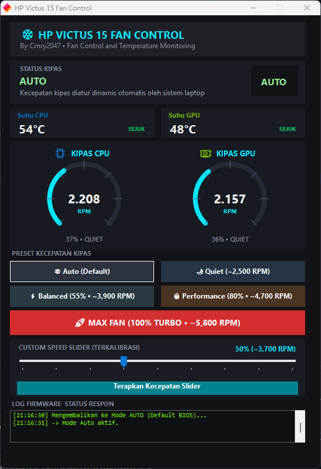
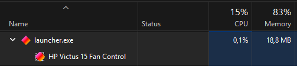

# HP Victus 15 Fan Control

HP Victus 15 Fan Control adalah aplikasi Windows ringan (lightweight) yang dirancang khusus untuk mengontrol mode kipas serta memantau suhu dan RPM CPU/GPU yang ditujukan untuk HP Victus 15, termasuk FA1094TX dan seri 15-fa/15-fb. Ketersediaan fitur bergantung pada model, BIOS, dan firmware.

Aplikasi ini hadir sebagai alternatif yang hemat sumber daya (low-resource) dibanding OMEN Gaming Hub, memungkinkan kamu mengatur pendinginan sistem secara cepat tanpa beban background process yang berat.

## Preview Aplikasi

## Fitur

- Koneksi WMI Native HP: Berkomunikasi langsung dengan Embedded Controller (EC) / ACPI BIOS HP untuk beralih mode pendinginan secara aman.
- Manajemen Mode Kipas: Pengaturan mode kipas cepat (seperti Auto, Quiet, hingga Max Fan Speed) sesuai kebutuhan beban kerja.
- Pemantauan Real-Time: Menampilkan suhu CPU/GPU serta pembacaan estimasi RPM kipas secara aktual.
- Ringan & Portabel: Tanpa perlu instalasi rumit (standalone executable), tidak memakan memori RAM secara berlebih.
- **Auto** — mengembalikan pengaturan kipas ke kontrol otomatis BIOS.
- **Quiet** — preset senyap, target sekitar 2.500 RPM.
- **Balanced** dan **Performance** — preset kecepatan kipas untuk beban sedang dan tinggi.
- **MAX FAN** — meminta kecepatan kipas maksimum.
- Slider untuk memilih level kipas secara manual.
- Tampilan tachometer kipas CPU/GPU, suhu, status, dan log firmware.

Angka RPM preset merupakan perkiraan; kecepatan aktual ditentukan firmware dan kondisi laptop. Sensor suhu atau RPM tertentu mungkin tidak tersedia pada semua model.

## Cara Menjalankan Aplikasi

1. Download Releases ZIP file, Lalu ekstrak file tersebut.
2. Buka folder  `Victus 15 Fan Control`.
3. Jalankan `launcher.exe`.
4. Setujui permintaan hak Administrator (UAC).

## Catatan

- Kontrol kipas berinteraksi langsung dengan firmware BIOS. Pilih **Auto** untuk mengembalikan kendali kipas ke profil BIOS.
- Pantau suhu saat menggunakan pengaturan manual dan jangan menghalangi ventilasi laptop.
